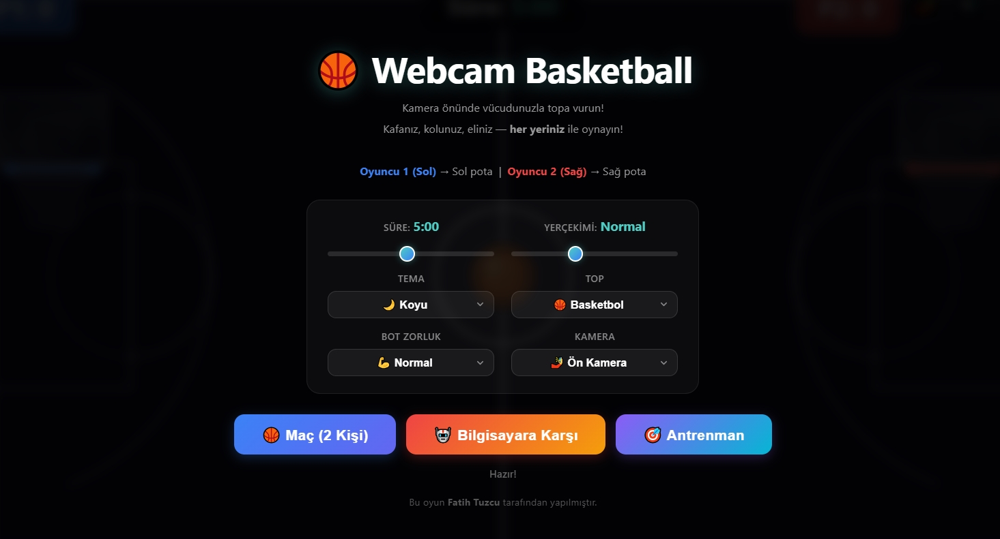

# 🏀 Webcam Basketball

Web kameranızı kullanarak vücut hareketlerinizle oynayabileceğiniz, yapay zekâ/hareket takibi destekli interaktif bir tarayıcı basketbol oyunu. 

Kafanız, elleriniz, kollarınız veya vücudunuzun herhangi bir bölümüyle ekrandaki topa vurun, basket atın ve rekabetin tadını çıkarın!

🌐 **Canlı Demo:** [basketbol.free.nf](https://basketbol.free.nf/?i=1)



## ✨ Özellikler

- **Vücut/Hareket Takibi (Motion Tracking):** Kamera karşısında klavye veya fareye dokunmadan tamamen doğal hareketlerinizle topa yön verin.
- **3 Farklı Oyun Modu:**
  - 🏀 **Maç (2 Kişi):** Ekranı ikiye bölün; Oyuncu 1 (Sol) sol potaya, Oyuncu 2 (Sağ) sağ potaya karşı arkadaşınızla birebir mücadele edin.
  - 🤖 **Bilgisayara Karşı:** Farklı zorluk seviyelerine sahip yapay zekâ bota karşı yeteneklerinizi sergileyin.
  - 🎯 **Antrenman Modu:** Skor baskısı olmadan tek başınıza atış ve hareket alıştırmaları yapın.
- **Kişiselleştirilebilir Ayarlar:**
  - ⏱️ **Süre Ayarı:** Maç uzunluğunu belirleyin.
  - 🌌 **Yerçekimi (Fizik) Ayarı:** Normal, düşük veya yüksek yerçekimi seçenekleri.
  - 🎨 **Görsel Temalar:** Koyu / Açık tema desteği.
  - ⚽ **Top Seçenekleri:** Farklı spor topu modelleri.
  - 📹 **Kamera Seçimi:** Çoklu kamera desteği (Ön Kamera / Harici Kameralar).

---

## 🎮 Nasıl Oynanır?

1. Web sitesini açın ve tarayıcınızın **kamera erişim iznini** onaylayın.
2. Kameranızın sizi rahatça görebileceği bir mesafede (yaklaşık 1.5 - 2 metre) konumlanın.
3. Menüden oyun modunu ve tercih ettiğiniz ayarları seçin:
   - **Oyuncu 1 (Sol Pota)** | **Oyuncu 2 (Sağ Pota)**
4. Oyun başladığında elleriniz, kollarınız veya başınızla topa çarparak rakip potaya sokmaya çalışın!

---

## 🛠️ Kullanılan Teknolojiler

- **HTML5 & CSS3:** Modern arayüz tasarımı ve duyarlı (responsive) düzen.
- **JavaScript (ES6+):** Temel oyun döngüsü ve mekanikleri.
- **HTML5 Canvas / Fizik Motoru:** Top sekmeleri, pota çarpışmaları ve yerçekimi simülasyonu.
- **WebRTC / MediaDevices API:** Kamera akışı ve görüntü işleme.

---

## 🚀 Yerel Kurulum (Local Development)

Projeyi kendi bilgisayarınızda çalıştırmak isterseniz:

1. Depoyu klonlayın:
   ```bash
   git clone https://github.com/kullanici-adiniz/webcam-basketball.git
   ```

2. Proje dizinine gidin:
   ```bash
   cd webcam-basketball
   ```

3. Kamera izinlerinin (WebRTC) düzgün çalışabilmesi için projeyi bir yerel sunucu üzerinden başlatın:
   - **VS Code Live Server:** `index.html` dosyasına sağ tıklayıp *Open with Live Server* seçeneğini kullanabilirsiniz.
   - **Python:**
     ```bash
     python -m http.server 8000
     ```
   - **Node.js (http-server):**
     ```bash
     npx http-server
     ```

4. Tarayıcınızda açın: `http://localhost:8000`

---

## 👨‍💻 Geliştirici

Bu oyun **Fatih Tuzcu** tarafından geliştirilmiştir.

---


